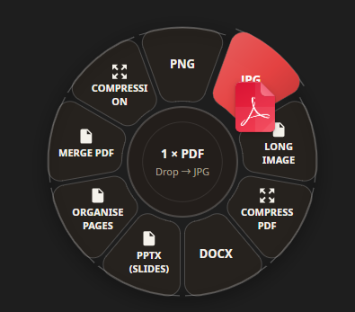
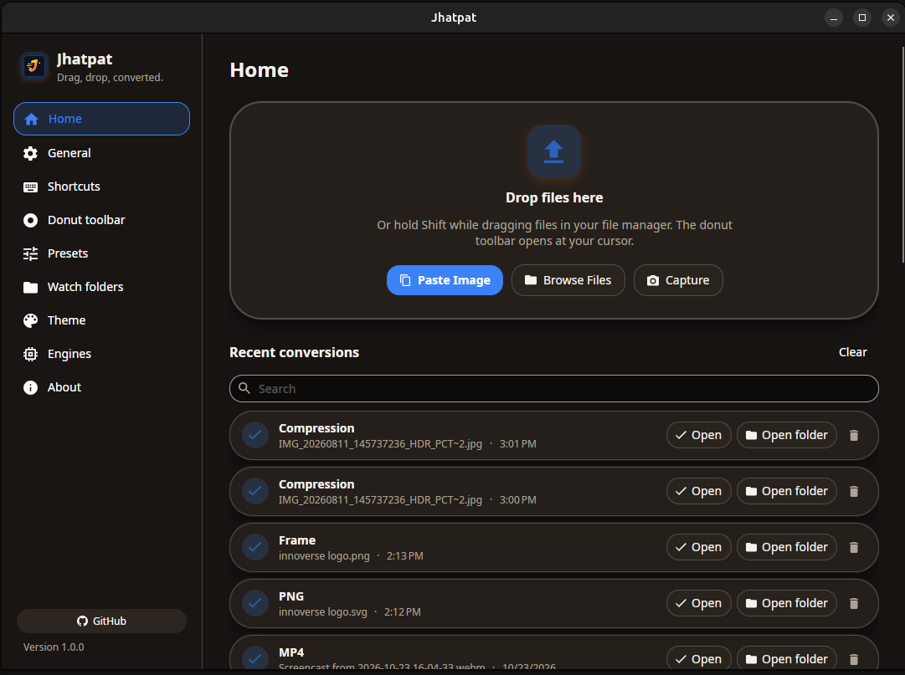
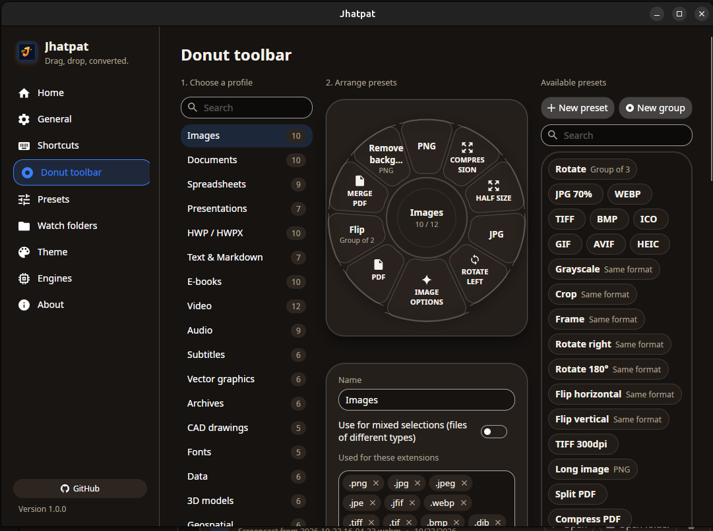

<p align="center">
  
</p>

<h1 align="center">Jhatpat</h1>

<p align="center">
  <strong>A cross-platform desktop utility for everyday file and image workflows.</strong><br>
  Built on the open-source <a href="https://github.com/KnifeLemon/Filee">Filee</a> project, with an evolving focus on contextual radial tools, image cropping, background framing, compression, batch processing, and clipboard workflows.
</p>

<p align="center">
  <strong>Built by <a href="https://github.com/AsadMokarim">AsadMokarim</a></strong>
</p>

<p align="center">
  <a href="https://github.com/InnoverseAMU/Jhatpat/releases/latest"><strong>Download</strong></a> ·
  <a href="#features"><strong>Features</strong></a> ·
  <a href="#technology-stack"><strong>Tech Stack</strong></a> ·
  <a href="#project-background--development"><strong>Development Approach</strong></a> ·
  <a href="#upstream-acknowledgement"><strong>Upstream Attribution</strong></a> ·
  <a href="#platform-support-status"><strong>Platform Support</strong></a> ·
  <a href="#packaging--installation"><strong>Install & Packaging</strong></a> ·
  <a href="#development"><strong>Development</strong></a> ·
  <a href="#license"><strong>License</strong></a>
</p>

<p align="center">
  
  
  
  
  <a href="LICENSE"></a>
</p>

> [!NOTE]
> **Jhatpat is an experimental, actively developed desktop application.** It builds upon the open-source Filee project and is being developed with AI-assisted coding tools. Features and platform compatibility are still being reviewed and validated. See the platform support section for the current status.

## Overview

Jhatpat is an ongoing project exploring how everyday file and image workflows can be brought together in a desktop application. It builds on Filee's existing conversion infrastructure while exploring additional image-manipulation tools and workflow improvements.

The project is not yet a stable, fully validated release. Feature availability and behaviour may vary by platform, and the documentation will evolve as testing continues.

## Features

The following describes functionality present in the current codebase; individual workflows and platform-specific behaviour still require ongoing validation.

### 1. Contextual Radial Workflows & Image Tools

- **Cursor-centric radial menu:** A circular menu designed to appear near the mouse cursor, invoked through a modifier key or context-menu workflow.
- **Ctrl + drag-and-drop conversion:** Hold **Ctrl**, drag files, and drop them onto a format in the donut menu that opens at your cursor to quickly start the relevant file workflow.
- **Image tools submenu:** Entry points for cropping, background framing, and compression/resizing of supported raster images.

### 2. Interactive Image Cropping

- **Aspect-ratio presets:** 1:1, 4:3, 16:9, 3:2, and freeform cropping.
- **Live preview and controls:** Crop handles, size indicators, and reset controls.
- **Export and clipboard workflows:** Designed to avoid silently overwriting the source image and to support copying processed images to the clipboard.

### 3. Background Framing

- **Background options:** Solid colours, linear gradients, custom image backgrounds, and transparency.
- **Styling controls:** Padding, corner radius, and drop-shadow settings.
- **Canvas dimensions:** Aspect-ratio presets, preset dimensions, and custom width and height.

### 4. Image Resizing & Compression

- **Custom dimensions:** Width and height controls with aspect-ratio locking.
- **Scale presets:** 25%, 50%, 75%, and 100%.
- **Quality controls:** Quality settings for lossy formats such as JPEG and WebP, with PNG handling intended to preserve lossless output.

### 5. Multi-File Batch Processing

- **Queue management:** Add multiple files or folders, with drag-and-drop support where available.
- **Shared parameters:** Apply resizing, maximum dimensions, output formats, and quality settings to queued images.
- **Collision handling:** Options intended to avoid overwriting existing files, including renamed outputs or skipping collisions.
- **Progress and cancellation:** Per-file progress, overall progress, and cancellation controls.

### 6. Clipboard & Screen Capture

- **Clipboard input:** Paste images into the application using the interface or keyboard shortcuts where supported.
- **Clipboard output:** Copy processed images from supported image-tool workflows.
- **Screen capture:** Region capture integrations for supported Linux desktop environments, including Wayland GNOME Shell D-Bus, Spectacle, or X11 ImageMagick `import`, depending on the installed environment.

### 7. Recent Activity, Preferences & Localization

- **Recent activity:** Open output files using the operating system's default handler, remove individual history entries, or clear history.
- **Persistent preferences:** Configure default image format, compression quality, and aspect-ratio behaviour.
- **Session state:** Remember recent export and batch directories between launches.
- **Localization:** Language resources are present for English (`en`), Spanish (`es`), Hindi (`hi`), Japanese (`ja`), Korean (`ko`), Polish (`pl`), and Simplified Chinese (`zh-CN`). Translation completeness and consistency may vary.

## Screenshots

Add screenshots or a short GIF of the current application here. Prefer images captured from a real, working build and label any experimental workflows.

<!-- Example:
-->
<p align="center">
  
  
  

</p>

## Project Background & Development

Jhatpat began as an exploration of desktop productivity tools after I came across the “Reverse Engineer Anything” trend and discovered Tangerine, a desktop utility for macOS. While researching alternatives, I found Filee, an open-source project that became the foundation for this experiment.

I use AI-assisted coding tools to guide implementation, explore design ideas, and iterate on the application. My contribution so far has focused on product direction, feature planning, and guiding the development process through instructions to AI tools.

This is an ongoing learning and development project. I have not yet personally reviewed the codebase line by line, so generated code, application behaviour, security, and platform compatibility require continued review and validation. The project should not be interpreted as a claim that every implementation detail has been independently engineered or audited.

Jhatpat is an independent project derived from Filee. It is not affiliated with or endorsed by the creators of Tangerine or Filee.

## Technology Stack

The codebase currently uses or references the following technologies. Exact versions and platform-specific dependencies should be checked against the project files before contributing.

- **Runtime and language:** .NET 10 / C#
- **Desktop UI:** Avalonia UI, using XAML and a Fluent theme
- **Architecture:** Model–View–ViewModel (MVVM), with `CommunityToolkit.Mvvm`
- **2D graphics and text rendering:** SkiaSharp and HarfBuzzSharp
- **Image processing:** Magick.NET / ImageMagick
- **Input and global hotkeys:** SharpHook
- **Linux packaging:** `dpkg-deb`, `tar`, `gzip`, and Freedesktop desktop utilities

## Upstream Acknowledgement

Jhatpat builds upon **[Filee](https://github.com/KnifeLemon/Filee)**.

- **Upstream repository:** https://github.com/KnifeLemon/Filee
- **Original author:** Myeonggu Kim ([KnifeLemon](https://github.com/KnifeLemon)) and Filee contributors
- **Upstream license:** MIT, as identified by the upstream project; consult the upstream repository and included license notices for the applicable terms.

Jhatpat reuses and adapts parts of Filee's conversion catalog, preset schemas, engine infrastructure, and configuration workflows while exploring an expanded direction focused on image manipulation, framing, compression, and desktop productivity.

This acknowledgement does not replace any copyright, license, or third-party notices required by the upstream project or bundled dependencies. Please see `LICENSE` and `THIRD-PARTY-NOTICES.md`.

## Platform Support Status

Platform support is still being validated. The table below distinguishes the current development target from features that need testing on native systems.

| Platform | Current status | Notes |
| :--- | :--- | :--- |
| **Linux — Ubuntu 24.04 LTS x64** | Primary development target | Linux packaging and runtime behaviour should be validated on the target machine and desktop session. Wayland and X11 integrations may behave differently. |
| **Windows 10 / 11 x64** | Preview; native testing required | A successful cross-platform build or publish does not confirm runtime behaviour. Explorer context-menu integration, notification icons, registry changes, and other Windows-specific features need testing on Windows. See [`docs/windows-compatibility-audit.md`](docs/windows-compatibility-audit.md), if present. |
| **macOS 14+ — ARM64 / x64** | Preview; validation required | Some platform infrastructure may be inherited from upstream Filee. Jhatpat-specific behaviour must be verified on supported macOS hardware before claiming compatibility. |

> [!WARNING]
> Do not interpret a successful build or package creation as proof that every feature works. Native runtime tests are required for each supported operating system and desktop environment.

## Packaging & Installation

Linux packaging scripts and release artifacts may change while the project is under development. The following commands reflect the current repository workflow and should be checked against the latest scripts and available artifacts.

### Ubuntu 24.04 LTS / Debian package

If `scripts/package-ubuntu.sh` is available in your checkout:

```bash
./scripts/package-ubuntu.sh --version 1.0.0
```

If the script completes successfully and creates the expected package, install it with:

```bash
sudo apt install ./build/dist/jhatpat_1.0.0_amd64.deb
```

### Standalone tarball

If a matching tarball and installer are present in `build/dist/`:

```bash
tar -xzf build/dist/jhatpat-1.0.0-linux-x64.tar.gz
cd jhatpat-1.0.0
./install.sh
```

For detailed package layout and removal instructions, see the [Ubuntu Packaging Guide](docs/ubuntu-packaging.md), if present.

**Note:** Version numbers and filenames above are examples. Use the actual version and artifact names produced by your build.

## Development

### Prerequisites

- [.NET 10 SDK](https://dotnet.microsoft.com/download/dotnet/10.0)

Additional platform-specific tools may be needed for screen capture, packaging, or native integrations.

### Clone the repository

```bash
git clone https://github.com/InnoverseAMU/Jhatpat.git
cd Jhatpat
```

### Build

The solution file in this repository is named `Filee.slnx`:

```bash
dotnet build Filee.slnx
```

### Run the desktop application

```bash
dotnet run --project src/Filee.App
```

### Run tests

Run the relevant test projects and inspect the results rather than relying only on the process exit code or a successful build.

```bash
dotnet test tests/Filee.App.Tests
```

The test command above targets the application test project only. Run the other test projects separately if you need a broader test assessment. Some tests or native UI workflows may require platform-specific environments.

## Contributing & Feedback

Feedback, bug reports, and suggestions are welcome. Since Jhatpat is actively being developed, please include:

- Your operating system and version.
- Steps to reproduce the issue.
- Expected behaviour and what happened instead.
- Relevant logs or screenshots, with personal information removed.

Before contributing, review the upstream license obligations and third-party notices. Pull requests should describe the changes and the tests or manual checks performed.

## License

Jhatpat is distributed under the terms stated in the repository's [`LICENSE`](LICENSE) file. The upstream Filee project and bundled third-party components retain their applicable copyright and license terms; see [`THIRD-PARTY-NOTICES.md`](THIRD-PARTY-NOTICES.md).

Do not rely on this README alone to determine licensing obligations. Verify that the repository's license files and notices accurately reflect the upstream project and all redistributed components.

<!-- sponsors: src/Filee.App/Assets/Sponsors/sponsors.json -->
