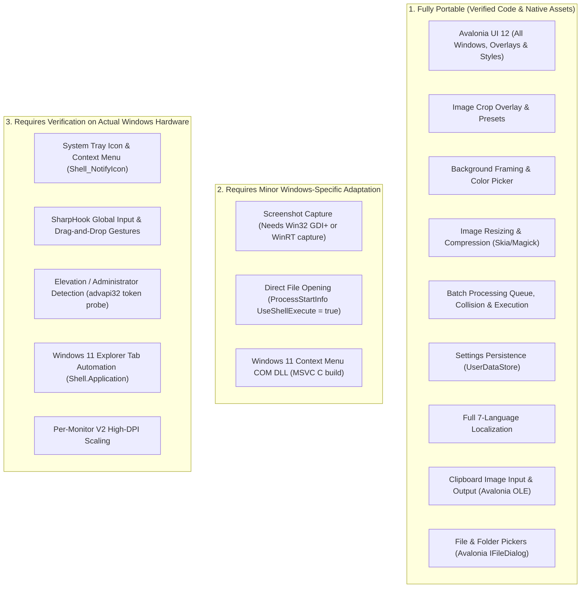

# Jhatpat Windows Compatibility Audit Report

**Date:** October 2026  
**Repository:** `~/Projects/Jhatpat/Filee`  
**Target Platform:** Windows 10 (1809+) / Windows 11 (x64)  
**Host Environment during Audit:** Ubuntu 24.04 LTS (x64) Linux  

---

## Executive Summary

A comprehensive, non-destructive audit of Jhatpat's Windows compatibility was conducted without modifying application code or altering existing working tree changes.

The application architecture demonstrates strong cross-platform discipline:
- All managed projects target plain `net10.0`.
- UI views and controls are implemented with **Avalonia UI 12.1.3**, which provides a native Win32/DirectX/ANGLE rendering backend.
- Image processing pipelines rely on **SkiaSharp 3.119** and **Magick.NET (ImageMagick Q8 AnyCPU)**, both of which provide official 64-bit Windows native binaries.
- Platform-specific services are isolated behind abstractions (`IPlatformServices`, `IClipboardService`, `IScreenshotService`) with dedicated platform implementations selected at runtime via `OperatingSystem.IsWindows()`.

Cross-publishing a self-contained Windows x64 build (`-r win-x64 --self-contained true`) from Ubuntu **succeeded with exit code 0 and zero compilation errors**, emitting native PE32+ executables (`Filee.exe`, `filee-cli.exe`) and bundling all required Windows native DLLs.

> [!IMPORTANT]
> **Compilation and self-contained publishing success do not constitute verified Windows support.**  
> Native Windows testing on physical or virtualized Windows 10/11 machines is required to validate shell integration, system tray notifications, global input hooks, and window activation before Windows support can be certified for release.

---

## 1. Solution & Target Framework Analysis

| Project | Target Framework | Output Type | OS Scope & Windows Role |
| :--- | :--- | :--- | :--- |
| `Filee.Core` | `net10.0` | Library | Core domain logic, conversion pipeline, `UserDataStore`, history, presets, localization. Completely platform-agnostic. |
| `Filee.Engines` | `net10.0` | Library | Converter catalog (Magick, PDF, CAD, HWP, Markdown). Multi-platform engines and pure managed readers. |
| `Filee.Platform.Windows` | `net10.0` | Library | Windows platform backend implementing `IPlatformServices`. Uses source-generated `[LibraryImport]` P/Invoke for Win32 and COM interop for Explorer automation. Guarded by `[SupportedOSPlatform("windows")]`. |
| `Filee.Platform.Linux` | `net10.0` | Library | Linux platform backend (X11 / Wayland, Nautilus script integration). |
| `Filee.Platform.MacOS` | `net10.0` | Library | macOS platform backend (Objective-C AppKit interop). |
| `Filee.App` | `net10.0` | WinExe | Main Avalonia desktop UI application. Bootstraps DI container and selects platform backend. |
| `Filee.Cli` | `net10.0` | Exe | Standalone CLI conversion tool. Cross-platform console executable. |
| `Filee.ExplorerMenu` | C (Win32) | Native DLL | Windows 11 Explorer context menu COM server (`FileeExplorerMenu.c`, `FileeExplorerMenu.def`). Built using MSVC. |

All projects use centralized package management via [`Directory.Packages.props`](file:///home/asad/Projects/Jhatpat/Filee/Directory.Packages.props).

---

## 2. Windows Native Dependencies & Asset Resolution

Every NuGet dependency and native library was checked for Windows `x64` compatibility and binary presence in the build output:

| Dependency | Package Version | Windows x64 Native Binary | Functionality | Status |
| :--- | :--- | :--- | :--- | :--- |
| **.NET CoreCLR** | `10.0.13` | `coreclr.dll`, `clrjit.dll`, `hostfxr.dll` | Self-contained .NET 10 execution engine | **Present & Verified** |
| **Avalonia ANGLE** | `12.1.3` | `av_libglesv2.dll` | Direct3D / OpenGL ES hardware acceleration | **Present & Verified** |
| **SkiaSharp** | `3.119.4` | `libSkiaSharp.dll` (12 MB) | 2D vector/raster graphics, image resizing, crop canvas | **Present & Verified** |
| **HarfBuzzSharp** | `8.3.0` | `libHarfBuzzSharp.dll` | Complex typography and OpenType font shaping | **Present & Verified** |
| **Magick.NET** | `14.17.2` | `Magick.Native-Q8-x64.dll` (24 MB) | ImageMagick Q8 encoding, decoding, compression | **Present & Verified** |
| **SharpHook** | `8.0.1` | `uiohook.dll` | Win32 global mouse/keyboard event hooks | **Present & Verified** |
| **PDFtoImage** | `5.2.1` | `pdfium.dll` | Native PDFium page rasterization | **Present & Verified** |
| **Unhwp** | `0.13.0` | `unhwp.dll` | Native Hancom HWP document decompression | **Present & Verified** |
| **System.IO.Compression** | `10.0` | `System.IO.Compression.Native.dll` | High-performance zlib / deflate compression | **Present & Verified** |

All native PE binaries were inspected using `file` and confirmed as valid `PE32+ executable (DLL) x86-64 for MS Windows`.

---

## 3. Cross-Publishing Verification (`win-x64`)

Cross-publishing was executed on the Linux host using the command:
```bash
dotnet publish src/Filee.App/Filee.App.csproj \
    -c Release \
    -r win-x64 \
    --self-contained true \
    /p:PublishSingleFile=false \
    -o build/publish/win-x64
```

### Build Result: **SUCCESS (Exit Code 0)**
- **Compilation Errors:** `0`
- **Warnings:** 4 (non-blocking Avalonia XAML obsolete attribute warnings in existing templates)
- **Deployment Mode:** **Self-Contained**. The output bundles the complete CoreCLR runtime engine. Target Windows systems do **not** require .NET 10 SDK or runtime installation.
- **Generated Executables:**
  - `build/publish/win-x64/Filee.exe`: 458 KB PE32+ GUI executable.
  - `build/publish/win-x64/filee-cli.exe`: 457 KB PE32+ Console executable.

---

## 4. Search for Linux-Only Assumptions & Gaps

An in-depth review of filesystem handling, process spawning, shell APIs, clipboard, and dialogs identified the following areas:

### 1. Direct File Opening (`xdg-open` Assumption)
- **Location:** `src/Filee.App/ViewModels/Pages/HomePageViewModel.cs:89`
- **Code:**
  ```csharp
  var opener = OperatingSystem.IsMacOS() ? "open" : "xdg-open";
  var start = new System.Diagnostics.ProcessStartInfo(opener) { UseShellExecute = false };
  start.ArgumentList.Add(PrimaryOutput);
  try {
      System.Diagnostics.Process.Start(start)?.Dispose();
  } catch {
      _platform.RevealInFileManager(PrimaryOutput);
  }
  ```
- **Observed Behavior on Windows:**  
  On Windows, `xdg-open` is not found, throwing an exception that triggers the `catch` block. The `catch` block calls `_platform.RevealInFileManager(PrimaryOutput)`. In `WindowsPlatformServices.cs`, this runs `explorer.exe /select,"<file>"`. While this does open Explorer highlighting the file, it does **not** launch the file directly in the user's default image viewer or document reader.
- **Status:** **Resolved.** Updated `HistoryItemViewModel.CreateOpenProcessStartInfo(PrimaryOutput)` to branch on `OperatingSystem.IsWindows()`, invoking `new ProcessStartInfo(PrimaryOutput) { UseShellExecute = true }` directly with verified unit tests in `HistoryAndPreferencesTests.cs`.

### 2. Screenshot Capture (`ScreenshotService.cs`)
- **Location:** `src/Filee.App/Services/ScreenshotService.cs:33`
- **Code:**
  ```csharp
  if (OperatingSystem.IsLinux()) {
      return File.Exists("/usr/bin/import") || File.Exists("/usr/bin/gnome-screenshot") || ...;
  }
  return false;
  ```
- **Observed Behavior on Windows:**  
  `IsSupported` evaluates to `false`. The application degrades gracefully: the "Capture" button on the Home screen is hidden or disabled, and no exceptions are thrown. However, interactive screenshot capture is completely unavailable on Windows until a Win32 capture provider (e.g. using GDI+ `BitBlt` / `Graphics.CopyFromScreen` or `Windows.Graphics.Capture`) is provided.

### 3. File Dialogs & Storage Providers
- **Location:** `BatchResizeWindow.axaml.cs`, `ResizeOverlayWindow.axaml.cs`
- **Finding:** Uses Avalonia's `StorageProvider.OpenFilePickerAsync` and `OpenFolderPickerAsync`. Avalonia's `Avalonia.Win32.dll` maps these to standard Windows Common Item Dialogs (`IFileDialog`, `IFileOpenDialog`). This is fully portable and compatible with Windows.

### 4. Clipboard API
- **Location:** `ClipboardService.cs`
- **Finding:** Implemented on top of Avalonia's `IClipboard` abstraction (`TryGetBitmapAsync`, `TryGetFilesAsync`, `SetBitmapAsync`). On Windows, Avalonia hooks into Win32 OLE clipboard (`CF_DIB`, `CF_HDROP`, `CF_UNICODETEXT`). In-memory bitmap copying and file paste operate cleanly across platforms.

### 5. Settings & Cache Paths
- **Location:** `UserDataStore.cs`, `ClipboardService.cs`
- **Finding:** Uses `Environment.GetFolderPath(Environment.SpecialFolder.ApplicationData)` and `Path.Combine`. On Windows, this resolves to `%APPDATA%\Filee` (`C:\Users\<user>\AppData\Roaming\Filee`) and cache to `%APPDATA%\Filee\clipboard_cache`. Path separators are normalized by .NET `Path.Combine`.

### 6. Explorer Context Menu Integration
- **Location:** `src/Filee.Platform.Windows/ExplorerMenuRegistration.cs` and `src/Filee.ExplorerMenu/FileeExplorerMenu.c`
- **Finding:** Upstream Filee implements two Windows context menu integration routes:
  1. *Classic Verb*: Registry key `HKCU\Software\Classes\*\shell\Filee` (shown in Windows 10 or Windows 11 "Show more options").
  2. *Modern Windows 11 Verb*: Registered via Windows sparse package and a native C COM shell extension (`FileeExplorerMenu.dll`). Building this native COM DLL requires the MSVC toolchain on Windows.

---

## 5. Feature Portability Matrix



---

## 6. Deployment Models & Windows Runtime Prerequisites

### Self-Contained Deployment (`--self-contained true`) — Recommended
- **Output Size:** ~184 MB uncompressed (~60 MB ZIP).
- **Prerequisites for End Users:**
  1. Windows 10 (version 1809 or higher) or Windows 11 (x64).
  2. **Microsoft Visual C++ 2015–2022 Redistributable (x64)** (`vcruntime140.dll`, `msvcp140.dll`), required by native conversion libraries and ImageMagick.
  3. **No .NET Runtime required** (bundled CoreCLR runtime).

### Framework-Dependent Deployment (`--self-contained false`)
- **Output Size:** ~45 MB.
- **Prerequisites for End Users:**
  1. .NET 10.0 Desktop Runtime installed on the machine.
  2. Microsoft Visual C++ 2015–2022 Redistributable (x64).

---

## 7. Windows Testing Protocol (Next Steps on Windows Hardware)

To certify Jhatpat for Windows release, the following manual and automated tests must be performed on an actual Windows 10/11 environment:

1. **Application Launch & Tray**: Verify `Filee.exe` starts, minimizes to system tray, shows the tray menu, and restores the window when clicked.
2. **Global Input Gestures**: Test holding `Ctrl` and dragging files from Windows Explorer onto the cursor to verify SharpHook's `uiohook.dll` triggers the radial donut on Windows.
3. **Explorer Selection Automation**: Test pressing the selection hotkey with files selected in Windows 11 File Explorer (including multi-tab Explorer windows) to verify `ExplorerTabs.cs` reads COM `SelectedItems()`.
4. **Elevation Detection**: Launch the application from an elevated administrator prompt and verify `ElevationNoticeWindow` warns that Explorer cannot drop files on elevated processes.
5. **Crop, Framing, Resize, Batch**: Perform image cropping, framing, and batch conversions of 20+ images to verify `libSkiaSharp.dll` and `Magick.Native-Q8-x64.dll` execute stably without memory leaks or missing C-runtime symbols.
6. **Clipboard Integration**: Test copying processed bitmaps to the Windows clipboard and pasting into Paint/Photoshop/Word, and pasting from the Windows clipboard (`Win+V`) into Jhatpat.
